# Sangjun Pyo

데이터·금융·AI 문제를 직접 구조화하고, **실제로 돌아가는 서비스**로 만듭니다.
분석에서 끝내지 않고 배포·검증·기록까지 남기는 방식으로 일합니다.

---

## Featured Projects

<table>
<tr>
<td width="50%" valign="top">

### 🚗 EarlySignal
자동차 소비자 신고를 **LLM으로 증상 분류**하고, 차종별 **포아송 경보**와 원문 근거를 묶어 안전 담당자의 조사 요청서 작성을 돕는 도구.

NHTSA 신고 **93만 건** 적재 · **7,502건** LLM 분류 · 자동 검사 250개

  

[Demo](https://earlysignal.pages.dev/) · [Repo](https://github.com/SangJun-Pyo/EarlySignal)

</td>
<td width="50%" valign="top">

### 🧭 MyAiScore
공개 GitHub 저장소 URL 하나로 문서·검증·기록·자동화 신호를 읽어 **AI 개발 체계 점수**(100점)와 협업 유형을 보여주는 웹 서비스.

LLM 호출·코드 실행 없이 **결정론적 분석** · 근거 파일 경로 공개

  

[Demo](https://myaiscore-production.up.railway.app/) · [Repo](https://github.com/SangJun-Pyo/MyAiScore)

</td>
</tr>
<tr>
<td width="50%" valign="top">

### 🃏 PocketMeta
포켓몬 TCG Pocket의 **메타·티어 통계**를 보여주는 사이트. 기획부터 배포·운영까지 혼자 맡고 있는 라이브 서비스.

 

[Site](https://pocketmeta.app)

</td>
<td width="50%" valign="top">

### 📈 Markov-Trade
기대값·리스크·시나리오·복기 구조로 매매 판단을 재설계한 트레이딩 분석 시스템. **Claude Tool Use 차트 에이전트**, Monte Carlo 시뮬레이션, 매매 일지 분석 포함.

   

[Repo](https://github.com/SangJun-Pyo/Markov-Trade)

</td>
</tr>
<tr>
<td width="50%" valign="top">

### 💎 TRUVE
XRPL 기반 가상자산 기부 인프라. **Xaman 결제 → Evidence Package → XLS-70 Donation Credential** 발급·검증까지 연결하고, 기부금은 재단으로 직접 이동.

  

[Demo](https://truve.pages.dev/) · [Repo](https://github.com/SangJun-Pyo/Truve_prototype)

</td>
<td width="50%" valign="top">

### 📊 KOSIS_V2
KOSIS API 공공통계 수집 배치를 **Streamlit 운영 콘솔**로 리뉴얼. 지역·항목 선택 실행, 실패 작업 재실행, 실시간 로그·KPI, 결과 xlsx 관리.

  

[Repo](https://github.com/SangJun-Pyo/KOSIS_V2)

</td>
</tr>
</table>

<b>EarlySignal 더 보기</b>

- NHTSA 원본 신고 1,301,663행에서 필터·중복 제거 후 **932,821건** 적재
- 데모 범위 **7,502건**을 LLM으로 증상·상황 분류하고 출력·출처 검사 완료
- 직전 12개월 평균 대비 **Poisson 상측 확률 p<0.001** 규칙으로 차종-월 경보
- 경보 선택 → 원문 인용·제외 → 조사 요청서 저장을 한 흐름으로 연결, 판단은 사람이 내림
- 조사 사례 백테스트와 미래 데이터 차단 검증, 한계와 미검증 항목을 README에 그대로 공개

<b>Markov-Trade 더 보기</b>

- 기대값, 손익비, R-Multiple 기반 판단 구조와 Win Rate·Profit Factor·Max Drawdown·Equity Curve 분석
- Z-score, RSI, Bollinger Band 기반 다중 타임프레임 차트 분석
- Claude Tool Use 에이전트가 가격 조회·리스크 계산·매매 기록 도구를 호출해 진입·손절·목표가를 계획
- 매매 일지를 전략·종목·패턴별로 정량화하는 복기 시스템

<b>TRUVE 더 보기</b>

- 재단·캠페인 탐색 → Xaman 결제 → Evidence Package 생성 → Donation Credential 발급·승인 → 기부현황 확인
- 거래 해시, 기부 시점, 원화 환산 참고값, 캠페인 정보를 하나의 증빙 묶음으로 정리
- 재단 운영 흐름을 반영한 관리자 페이지와 외부 검증 페이지

<b>More</b>

- **VeriYeon** — DID/VC 기반 선택적 공개 신원 확인 매칭 프로토타입 (React · TypeScript) · [Repo](https://github.com/SangJun-Pyo/VeriYeon)
- **FANFI** — 음악 감상·팬 활동·토큰·NFT를 연결한 Web3 팬 이코노미 실험 (MetaMask, ERC-20/721/1155) · [Demo](https://fanfi-v1.pages.dev/)
- **Robprofile** — Roblox API 기반 유저·게임 정보 시각화 웹 서비스 · [Web](https://Robprofile.com/)

---

## Tech Stack

   
     
    

---

## Contribution Arcade

잉어 연못과 아케이드는 이 레포의 <a href="scripts">파이썬 스크립트</a>가 GitHub Actions로 매일 새로 그립니다.
